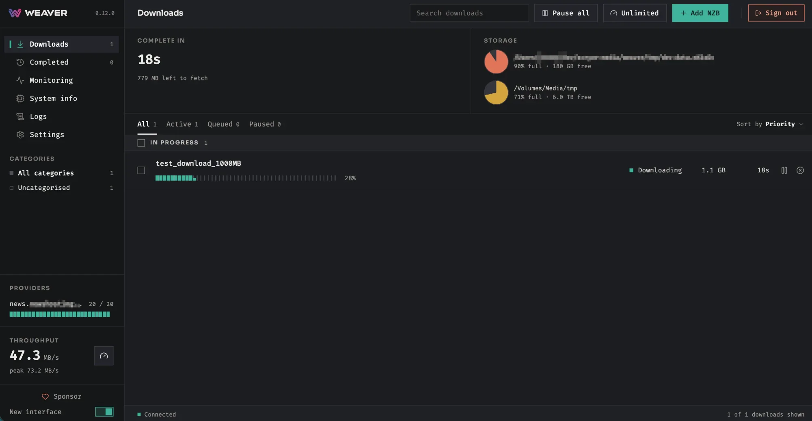
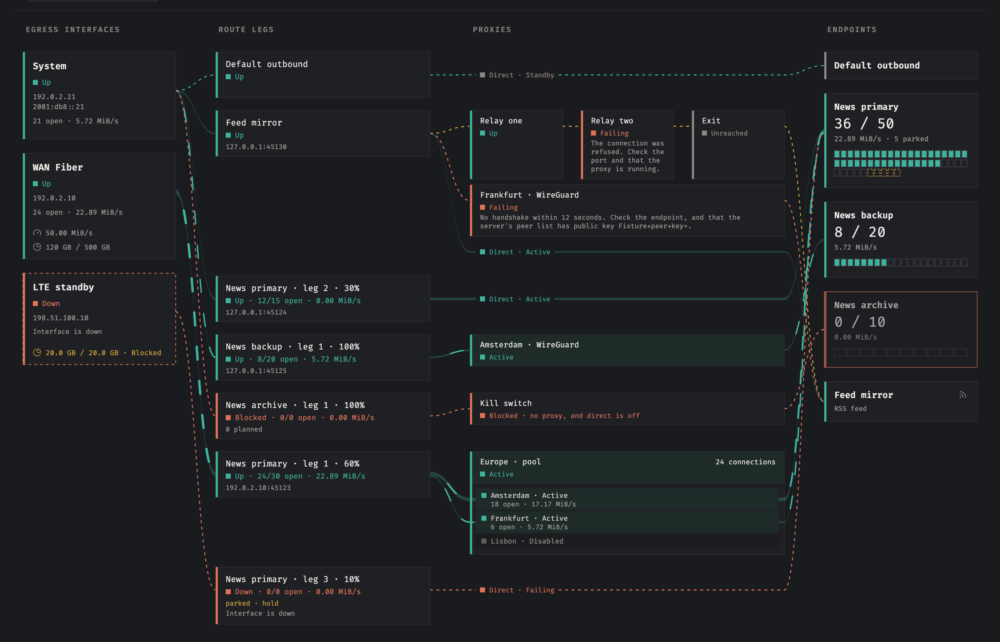

<h1 align="center">
  <picture>
    <source media="(prefers-color-scheme: dark)" srcset="docs/img/weaver-lockup-on-dark.svg" />
    
  </picture>
</h1>

  The fastest, most efficient, all-in-one Usenet downloader. 
  Download, repair, and extract — in a single binary.

  
  
  

  
  
  

  

## What is Weaver?

Weaver is a Usenet binary downloader that handles the entire pipeline — downloading articles, decoding, PAR2/PAR3 verification and repair, and extraction (RAR, 7z, etc) — all within a single self-contained binary. No need to install `rar`, `par2cmdline-turbo`, or any other external tools.

Built on [rarpar](https://github.com/scryer-media/rarpar), the fastest libraries for RAR extraction and PAR2/PAR3 repair.

Weaver runs a highly efficient pipeline that not only unpacks archives while downloading, for "store mode" RAR and 7z archives (the majority of binary content on Usenet), Weaver streams the file straight to your disk, no sepearate unpack. This makes it use far less CPU than even NzbGet.

## Key Features

- **Single binary** — no external tooling required, the final binary is small
- **Advanced Networking** - _See more below_
- **NZBGet API Facade** - [Add Weaver as NZBGet](https://www.scryer.media/weaver/docs/guides/nzbget-api/) to your favorite tools today
- **Ultra fast** — Weaver is performance tuned and architected for speed - [BENCHMARKS](https://www.scryer.media/weaver/benchmarks/)
- **Incremental extraction** — starts extracting files while still downloading, for all archive types
- **Real-time updates** — websocket push for job progress and system events, less chatty than other tools
- **Download limits** — configurable daily, weekly, or monthly data limits to work with ISP bandwidth caps. Speed limits per server and/or per WAN connection
- **Observable** — Built in metrics and timeline views help visualize what happens during download with support for prometheus 

## Advanced Networking
Weaver has an incredibly powerful networking sub system. It enables you to compose different building blocks into highly sophisticated netflows to ensure you're maximizing your bandwidth and privacy.

### Features
- **Multiple interface support** (have two ISPs? one Weaver can max them both!)
- **Proxy support** (Wireguard, SSH, SOCKS, etc)
- **Proxy chains** (Wireguard in Wireguard)
- **Proxy pools** (France VPN PoPs)
- **Killswitch** (_never connect to X from my ISP without proxy protection_)

## Compatability

| Tech   | Weaver | Sabnzbd | Nzbget |
| ------ | ------ | ------- | ------ |
| RAR    | ⭐️⭐️*   | ⭐️      | ⭐️     | 
| 7z     | ⭐️⭐️*   | ⭐️      | ⭐️     |
| Nested | ⭐️     | ⭐️      | ⭕️**    |
| ZIP    | ⭐️     | ⭐️      | ❌      |
| TAR    | ⭐️     | ⭐️      | ❌      |
| xz     | ⭐️     | ❌      | ❌      |
| zstd   | ⭐️     | ❌      | ❌      |
| br     | ⭐️     | ❌      | ❌      |
| gzip   | ⭐️     | ❌      | ❌      |
| bzip2  | ⭐️     | ❌      | ❌      |
| par2   | ⭐️     | ⭐️      | ⭐️      |
| par3***| ⭐️     | ❌      | ❌      |

_*Weaver supports "store mode" optimizations that directly materialize the binary file through a streaming decoder rather than download => decode_

_**Nzbget supports nested with an extension and it is limited in supported formats_

_***par3 spec is still in alpha, and Weaver is ready to use it today so you're never behind when posters start uploading with it. Par3 can be faster than par2 repair and also can repair much larger holes in files_

## Install

See [Installation](https://www.scryer.media/weaver/docs/installation/) for installation instructions

## API

Weaver exposes a **GraphQL API** at `/graphql` with full query, mutation, and subscription support. The same API powers the web UI, so anything you can do in the interface is available programmatically.

## Metrics & dashboards

Weaver serves comprehensive Prometheus metrics at `/metrics` 

## Technology Radar

Kernel and platform work in flight lives in [docs/technology-radar.md](docs/technology-radar.md).

## License

Weaver-authored source code is licensed under GPL-3.0-or-later. Official builds include `unrar-rs` for RAR support; that component remains subject to the UnRAR restriction; Weaver's GPL code combines with it under a GPLv3 section 7 linking permission. See [LICENSE](LICENSE) and [THIRD_PARTY_NOTICES.md](THIRD_PARTY_NOTICES.md) for details.
